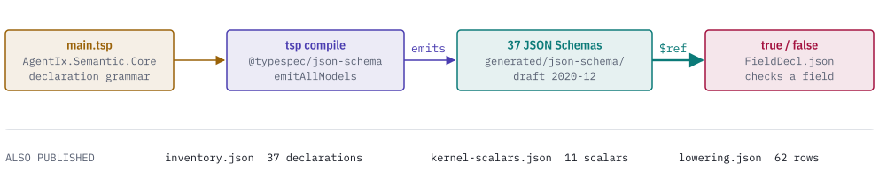
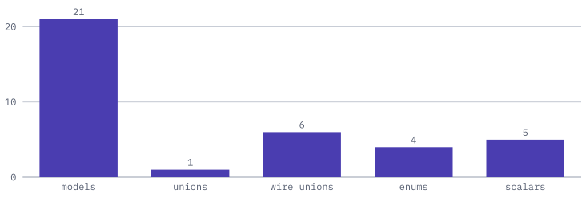

# @agent-ix/semantic-core

[](https://discord.gg/k8DVhuYBR2)
[](#license)

@agent-ix/semantic-core is the declaration grammar for semantic modules, written in
TypeSpec as the `AgentIx.Semantic.Core` namespace, together with the JSON Schema
documents generated from it. It defines what a field, type reference, constraint,
relation, operation, clause reference and enum value is, and the closed set of 11
kernel scalars a declaration can end in.

You can import the namespace into your own TypeSpec, or validate declarations as
JSON with the generated schemas and no build step.

<picture>
  <source media="(prefers-color-scheme: dark)" srcset="https://raw.githubusercontent.com/agent-ix/filament-core-data/main/packages/semantic-core/docs/images/hero-dark.svg">
  
</picture>

## Getting started

```sh
npm install @agent-ix/semantic-core
```

`@typespec/compiler` and `@typespec/json-schema` (both 1.15.0) are peer dependencies.
You need them only to compile `main.tsp`; the generated JSON Schema files need no build step.

To build from a clone of [filament-core-data](https://github.com/agent-ix/filament-core-data),
run `pnpm install`, then the targets under Building and testing.

## Usage

This TypeSpec file imports the namespace and compiles against it:

```tsp
import "@agent-ix/semantic-core";

using AgentIx.Semantic.Core;

model Invoice {
  total: TypeRef;
}
```

This script validates a field declaration with Ajv against `FieldDecl.json`. Run
`npm install ajv` first and save the script as an ES module, for example `validate.mjs`.
The schema checks the shape and the name, which must be an identifier. Rules that
JSON Schema cannot express, such as a `Decimal` field needing a `decimal` policy, are
enforced by the semantic-core reader.

```js
import Ajv2020 from "ajv/dist/2020.js";
import { readdirSync, readFileSync } from "node:fs";

const dir = "node_modules/@agent-ix/semantic-core/generated/json-schema";
const ajv = new Ajv2020({ strict: false });
for (const file of readdirSync(dir)) {
  ajv.addSchema(JSON.parse(readFileSync(`${dir}/${file}`, "utf8")));
}
const validate = ajv.getSchema("https://schemas.agent-ix.org/semantic-core/0.4.4/FieldDecl.json");

const field = {
  name: "amount",
  type: {
    target: { kind: "KernelScalar", value: "Decimal" },
    decimal: { precision: 12, scale: 2 },
  },
  constraints: [
    { kind: "MinConstraint", value: { keyword: "min", value: { kind: "number", value: 0 } } },
  ],
};
console.log(validate(field)); // true
console.log(validate({ name: "1bad", type: field.type })); // false, at /name
```

Replace `0.4.4` in the `$id` with the installed package version.

## Reference

| File | What it holds |
| --- | --- |
| `main.tsp` | The TypeSpec source of `AgentIx.Semantic.Core`. |
| `generated/json-schema/` | One JSON Schema (draft 2020-12) document per declaration, emitted from `main.tsp`. |
| `inventory.json` | The exact declaration inventory: models, unions, wire unions, enums and scalars. |
| `kernel-scalars.json` | For each kernel scalar: its IR scalar, bounds, serialization and whether a unit is allowed. |
| `lowering.json` | Each grammar property mapped to its IR node property. |

<picture>
  <source media="(prefers-color-scheme: dark)" srcset="https://raw.githubusercontent.com/agent-ix/filament-core-data/main/packages/semantic-core/docs/images/inventory-dark.svg">
  
</picture>

| Group | Members |
| --- | --- |
| Kernel scalars | `UUID`, `Boolean`, `Integer`, `Decimal`, `Float32`, `Float64`, `String`, `Timestamp`, `Duration`, `Bytes`, `JsonObject` |
| Edge categories | `structural`, `behavioral`, `dataflow`, `dependency`, `realization`, `governance`, `traceability` |
| Constraint keywords | `min`, `max`, `exclusiveMin`, `exclusiveMax`, `pattern`, `minLength`, `maxLength`, `enumValues`, `nonEmpty`, `unique`, `format` |
| Default kinds | `semantic`, `representation`, `migration` |
| Declarations | `FieldDecl`, `RelationDecl`, `OperationDecl`, `ClauseRef`, `EnumValue`, `ConstraintDecl`, `TypeRef`, `Multiplicity` |

Every generated schema `$id` and `$ref` is rooted at
`https://schemas.agent-ix.org/semantic-core/<version>/`, where `<version>` is this
package's version, so a release changes the identifiers with the version.

## Building and testing

From a clone of filament-core-data:

```sh
make semantic-core-compile    # compile main.tsp without emitting
make semantic-core-generate   # regenerate generated/json-schema/
make semantic-core-check      # fail on any byte difference from the committed schemas
```

## Contributing

Read [CONTRIBUTING.md](https://github.com/agent-ix/filament-core-data/blob/main/CONTRIBUTING.md)
and [CLA.md](https://github.com/agent-ix/filament-core-data/blob/main/CLA.md).

## License

Licensed under [AGPL-3.0-or-later](https://github.com/agent-ix/filament-core-data/blob/main/LICENSE).
