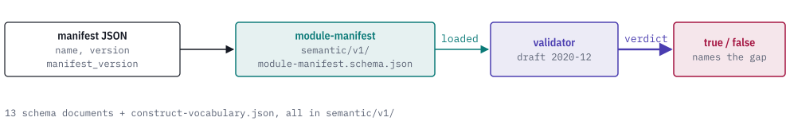

# @agent-ix/semantic-schema

[](https://discord.gg/k8DVhuYBR2)
[](#license)

@agent-ix/semantic-schema is the set of JSON Schema (draft 2020-12) documents for
the filament-core-data semantic package contract v1. It holds the schema for the
filament module manifest, including its optional `semantic` block, and the schemas
for the semantic IR and the compiler's request and output documents.

You load a document into any draft 2020-12 validator to check a manifest or contract
document before you use it. The package is data only, with no build step and no runtime
dependency.

<picture>
  <source media="(prefers-color-scheme: dark)" srcset="https://raw.githubusercontent.com/agent-ix/filament-core-data/main/schema/docs/images/hero-dark.svg">
  
</picture>

## Getting started

```sh
npm install @agent-ix/semantic-schema
```

The documents are in `node_modules/@agent-ix/semantic-schema/semantic/v1/`. To use a
clone of [filament-core-data](https://github.com/agent-ix/filament-core-data), read
them from `schema/semantic/v1/`.

## Usage

This script validates a module manifest with Ajv. Run `npm install ajv` first and
save the script as an ES module, for example `validate.mjs`. `common.schema.json` is
loaded as well, because `module-semantic-block.schema.json` references it.

```js
import Ajv2020 from "ajv/dist/2020.js";
import { readFileSync } from "node:fs";

const dir = "node_modules/@agent-ix/semantic-schema/semantic/v1";
const load = (file) => JSON.parse(readFileSync(`${dir}/${file}`, "utf8"));

const ajv = new Ajv2020({ strict: false });
ajv.addSchema(load("common.schema.json"));
const validate = ajv.compile(load("module-manifest.schema.json"));

console.log(validate({ manifest_version: "1.0.0", name: "billing", version: "1.0.0" })); // true
console.log(validate({ name: "billing" })); // false
console.log(validate.errors[0].message); // must have required property 'manifest_version'
```

## Reference

| Document | What it describes |
| --- | --- |
| `module-manifest.schema.json` | The filament module manifest, including its optional `semantic` block. |
| `module-semantic-block.schema.json` | The `semantic` block: the fields a module declares to describe itself as a semantic-core package. |
| `package-manifest.schema.json` | The semantic package manifest. |
| `compiler-request.schema.json` | The compiler request. |
| `output-manifest.schema.json` | The compiler output manifest. |
| `target-contract.schema.json` | The generated target contract. |
| `mapping.schema.json` | A semantic mapping. |
| `profile.schema.json` | A representation profile. |
| `representation.schema.json` | The representation contract. |
| `consumer-policy.schema.json` | The semantic consumer policy. |
| `compatibility-report.schema.json` | The semantic compatibility report. |
| `semantic-ir.schema.json` | The semantic IR (contract version 2.0.0). |
| `common.schema.json` | The common types the other documents share. |
| `construct-vocabulary.json` | The construct vocabulary. |

The module manifest requires `manifest_version`, `name` and `version`. The `semantic`
block requires `contract_version` and `package`.

Each document's `$id` has the form
`https://schemas.agent-ix.org/filament-core-data/v1/<file>`. The `v1` segment is the
contract version and does not change with the package version.

## Contributing

Read [CONTRIBUTING.md](https://github.com/agent-ix/filament-core-data/blob/main/CONTRIBUTING.md)
and [CLA.md](https://github.com/agent-ix/filament-core-data/blob/main/CLA.md).

## License

Licensed under [AGPL-3.0-or-later](https://github.com/agent-ix/filament-core-data/blob/main/LICENSE).
